# Tugas 2 IPSD — Klasifikasi Foto Kulit Mpox

## Anggota Kelompok & Jobdesk
- Carrissa Asti Widya Artanti — Dataset & Configuration (`cek_dataset.py`, `cek_ukuran.py`, `config.py`)
- Fauziah Istiqomah — Model Development (`Models/CNN.py`, `Utils/getData.py`)
- Dina Aulia Rizk — Model Training (`train.py`, `hasil_dengan_aug/`, `hasil_tanpa_aug/` untuk log & grafik training)
- Yumna Dhiyaul Auliyah — Model Testing & Evaluation (`test.py`, `hasil_5fold.csv`, `confusion_matrix_fold1-5.png`, perbandingan metrik)
- Eky Ayu Veriska — Documentation & Publication (`README.md`, `.gitignore`, repository GitHub, unggah video YouTube)

## Video
https://youtu.be/...

## Dataset
https://www.kaggle.com/datasets/joydippaul/mpox-skin-lesion-dataset-version-20-msld-v20

## Hasil (Rata-rata 5 Fold)
| Metrik | Dengan augmentasi | Tanpa augmentasi | Selisih |
|---|---|---|---|
| Accuracy | 0.482 | 0.412 | +0.070 |
| Precision | 0.440 | 0.342 | +0.099 |
| Recall | 0.482 | 0.412 | +0.070 |
| F1-score | 0.435 | 0.319 | +0.116 |
| ROC-AUC | 0.763 | 0.729 | +0.034 |

## Gambar 
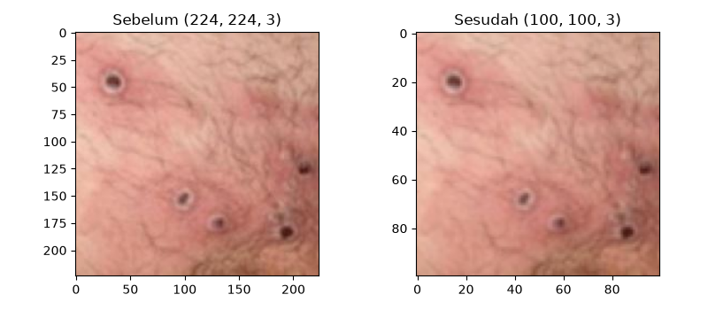

### Kurva loss, dengan augmentasi
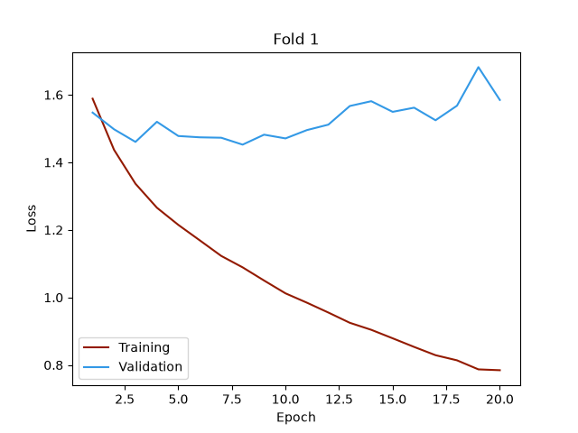
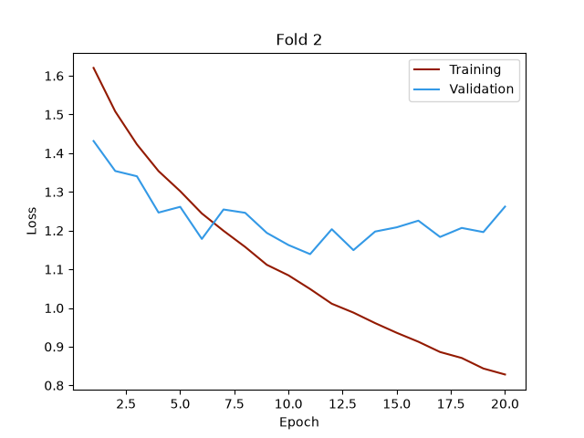
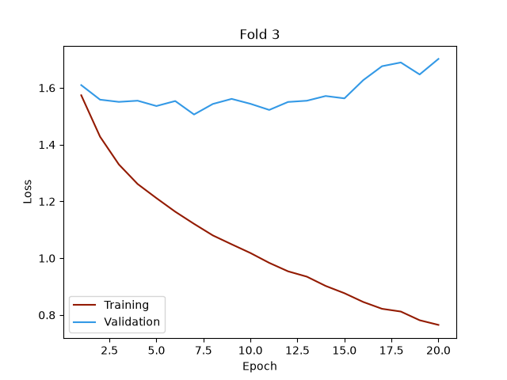
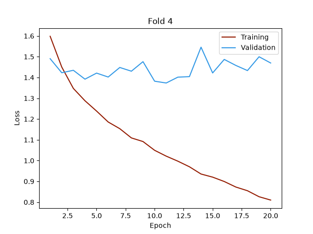
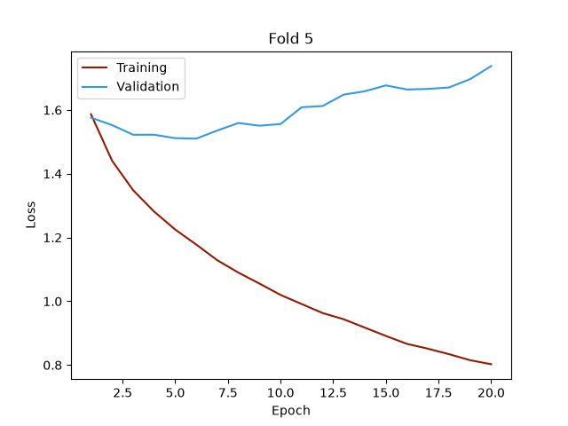

### Kurva loss, tanpa augmentasi
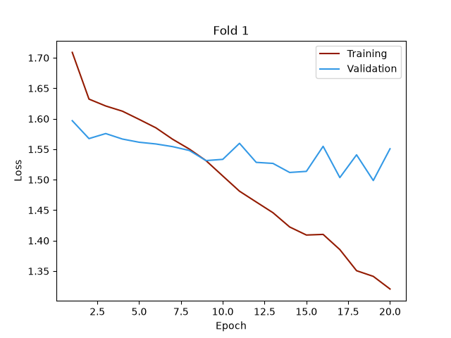
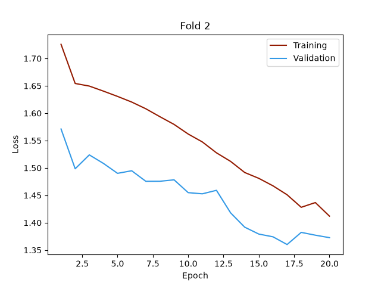
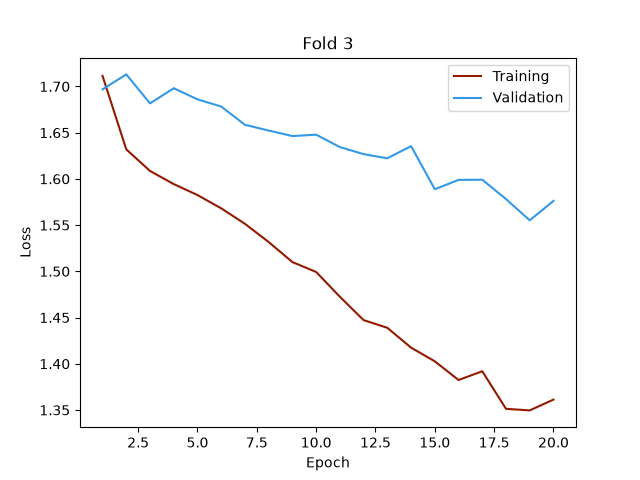
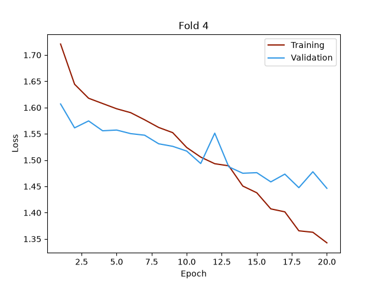
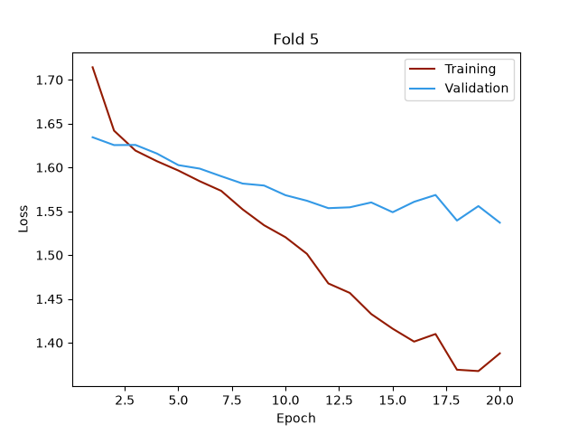

### Confusion matrix, dengan augmentasi
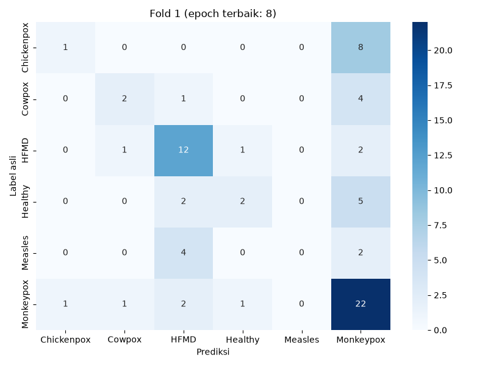
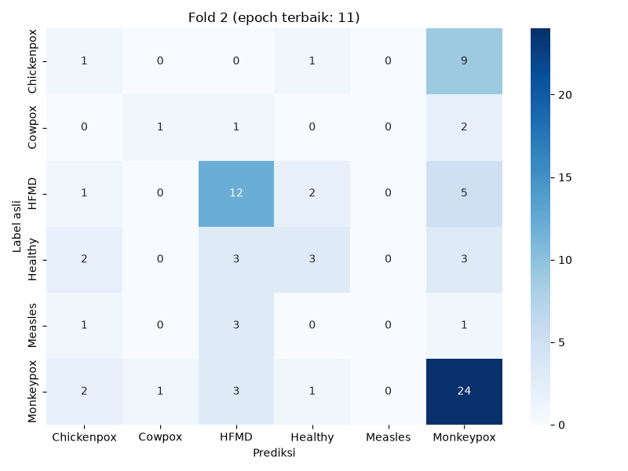
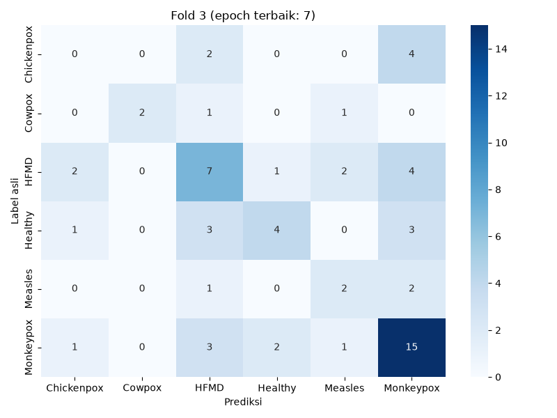

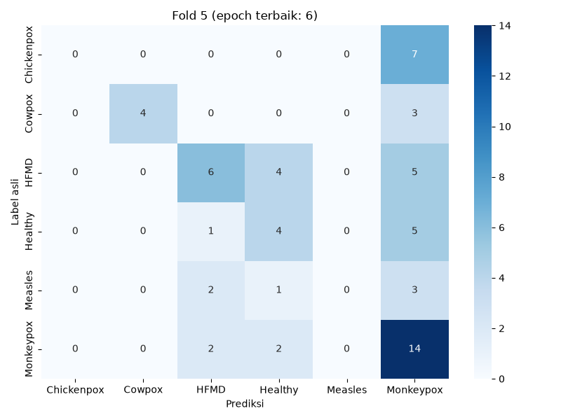

### Confusion matrix, tanpa augmentasi
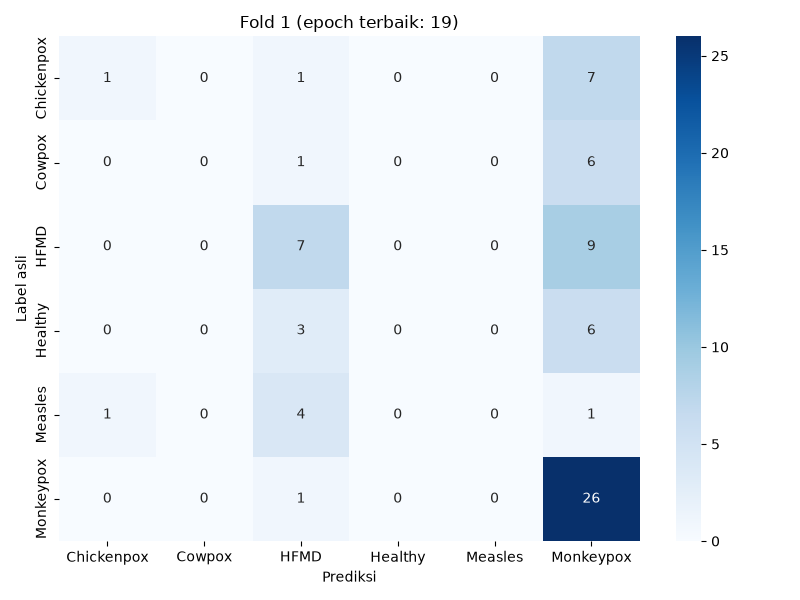
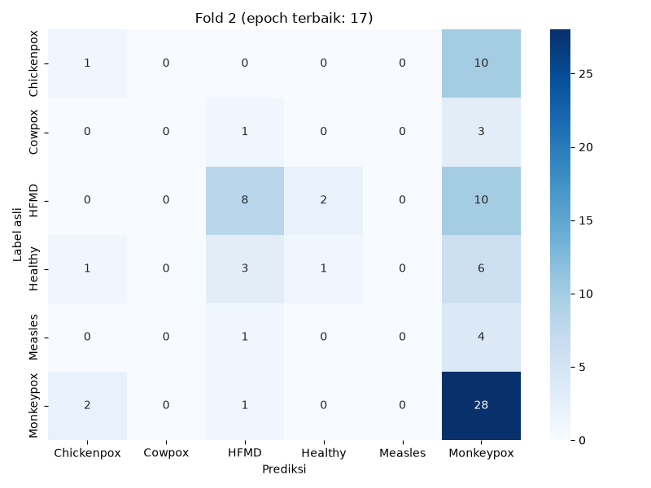
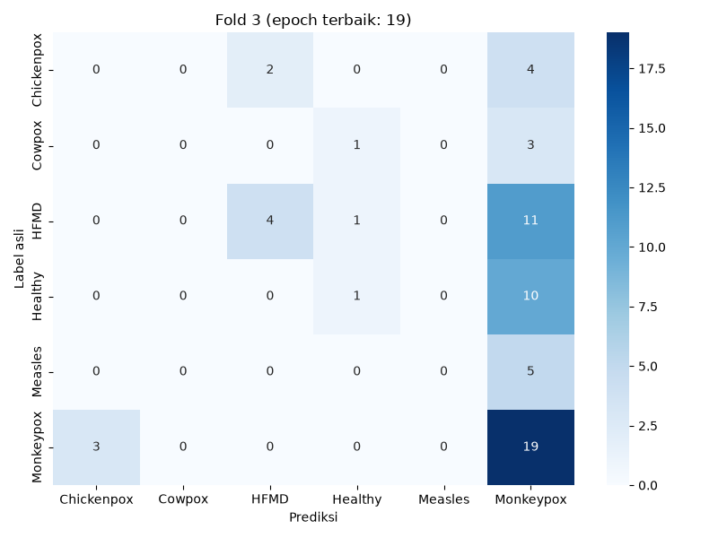


## Jawaban Pertanyaan
1. **Apakah data augmentasi membantu? Tunjukkan dengan angka rata-rata dari kedua percobaan.**
   
      Ya, augmentasi membantu meningkatkan hasil model. Semua metrik meningkat dengan augmentasi. Peningkatan terbesar terdapat pada F1-score, yaitu sebesar 0,116 Rata-rata accuracy 0,482 dengan augmentasi dan 0,412 tanpa augmentasi. Augmentasi membuat jumlah foto latih bertambah dari 537 menjadi sekitar 8.000 foto. Dengan begitu, model bisa belajar dari lebih banyak variasi gambar dan tidak hanya mengandalkan foto asli. Namun, peningkatan ini juga dipengaruhi oleh jumlah proses pelatihan yang lebih banyak saat menggunakan augmentasi.

2. **Kelas mana yang paling sering salah ditebak, dan tertukar dengan kelas apa? Mengapa menurut kalian?**
   
      Chickenpox paling sering salah ditebak. Dari 42 foto, hanya 2 yang benar, sedangkan 36 foto ditebak sebagai Monkeypox. Hal ini kemungkinan karena jumlah foto Monkeypox lebih banyak, sehingga model cenderung menebak kelas tersebut. Selain itu, Chickenpox, Cowpox, dan Monkeypox memiliki tampilan lesi kulit yang mirip, sehingga sulit dibedakan oleh model.

3. **Berapa recall kelas Monkeypox? Mengapa recall lebih penting daripada accuracy untuk penyakit menular?**
   
      Recall Monkeypox dengan augmentasi adalah 96 dari 125 foto atau sebesar 0,768 (76,8%). Recall penting karena menunjukkan seberapa banyak pasien yang benar-benar sakit berhasil terdeteksi. Pada penyakit menular, pasien yang tidak terdeteksi bisa terlambat mendapat penanganan dan berisiko menularkan penyakit. Sementara itu, accuracy hanya menunjukkan jumlah prediksi benar secara keseluruhan.

4. **Menurut kalian, mengapa model ini masih sering salah? Sebutkan satu cara untuk memperbaikinya.**
   
      Model masih sering salah karena jumlah data sedikit, jumlah foto setiap kelas tidak seimbang, dan model CNN yang digunakan masih sederhana. Ukuran foto yang kecil juga membuat detail lesi kulit kurang terlihat. Salah satu cara memperbaikinya adalah menggunakan transfer learning, seperti ResNet, yang sudah dilatih menggunakan banyak gambar sebelumnya sehingga dapat membantu model mengenali pola pada foto lesi kulit dengan lebih baik.
```[cite: 1, 3, 5, 6]
