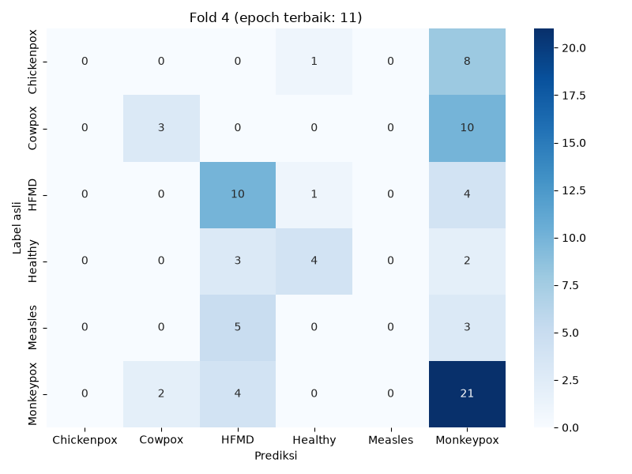
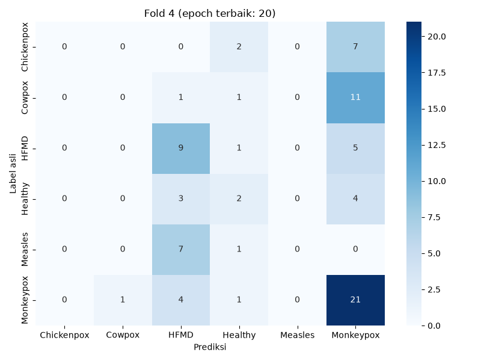
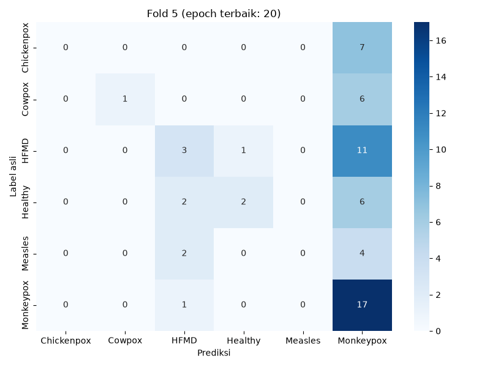

# Tugas 2 IPSD — Klasifikasi Foto Kulit Mpox

## Anggota Kelompok & Jobdesk
- Carrisa — Dataset & Configuration (`cek_dataset.py`, `cek_ukuran.py`, `config.py`)
- Fauziah — Model Development (`Models/CNN.py`, `Utils/getData.py`)
- Kiky — Model Training (`train.py`, `hasil_dengan_aug/`, `hasil_tanpa_aug/` untuk log & grafik training)
- Yumna — Model Testing & Evaluation (`test.py`, `hasil_5fold.csv`, `confusion_matrix_fold1-5.png`, perbandingan metrik)
- Vey — Documentation & Publication (`README.md`, `.gitignore`, repository GitHub, unggah video YouTube)

## Video
https://youtu.be/...

## Dataset
https://www.kaggle.com/datasets/joydippaul/mpox-skin-lesion-dataset-version-20-msld-v20

## Hasil (Rata-rata 5 Fold)
| Metrik | Dengan augmentasi | Tanpa augmentasi | Selisih |
|---|---|---|---|
| Accuracy | 0.482 | 0.412 | +0.070 |
| Precision | 0.440 | 0.342 | +0.099 |
| Recall | 0.482 | 0.412 | +0.070 |
| F1-score | 0.435 | 0.319 | +0.116 |
| ROC-AUC | 0.763 | 0.729 | +0.034 |

## Gambar 


### Kurva loss, dengan augmentasi


### Kurva loss, tanpa augmentasi


### Confusion matrix, dengan augmentasi





### Confusion matrix, tanpa augmentasi





## Jawaban Pertanyaan
1. **Apakah data augmentasi membantu? Tunjukkan dengan angka rata-rata dari kedua percobaan.**
   ...

2. **Kelas mana yang paling sering salah ditebak, dan tertukar dengan kelas apa? Mengapa menurut kalian?**
   ...

3. **Berapa recall kelas Monkeypox? Mengapa recall lebih penting daripada accuracy untuk penyakit menular?**
   ...

4. **Menurut kalian, mengapa model ini masih sering salah? Sebutkan satu cara untuk memperbaikinya.**
   ...
```[cite: 1, 3, 5, 6]

---

### Catatan saat mengisi `README.md` nanti
* **Bagian `## Gambar`:** Nama file di tanda kurung `(...)` harus sama persis dengan nama file yang ada di repo kalian (`cek_ukuran.png`, `hasil_dengan_aug/training_fold1.png`, dan `hasil_dengan_aug/confusion_matrix_fold1.png`) agar gambarnya muncul di GitHub[cite: 1, 3, 6].
* **Jawaban 4 pertanyaan:** Tulis dengan kalimat sendiri (sekitar 2–4 kalimat per nomor) dan rujuk angka rata-rata metrik serta *confusion matrix* dari hasil pengujian tim kalian[cite: 1, 3, 6].
* **Tautan video YouTube:** Masukkan setelah video live coding (10–15 menit) selesai diunggah ke YouTube dengan visibilitas **Public** atau **Unlisted** (jangan *Private*)[cite: 1, 3, 6].

Salin kerangka ini ke `README.md`, tekan **`Ctrl + S`**, lalu lanjut ke **Source Control** (`Ctrl + Shift + G`) untuk *Initialize Repository*, *Commit*, dan *Publish* ke GitHub sebagai repositori **Public**[cite: 1, 3].